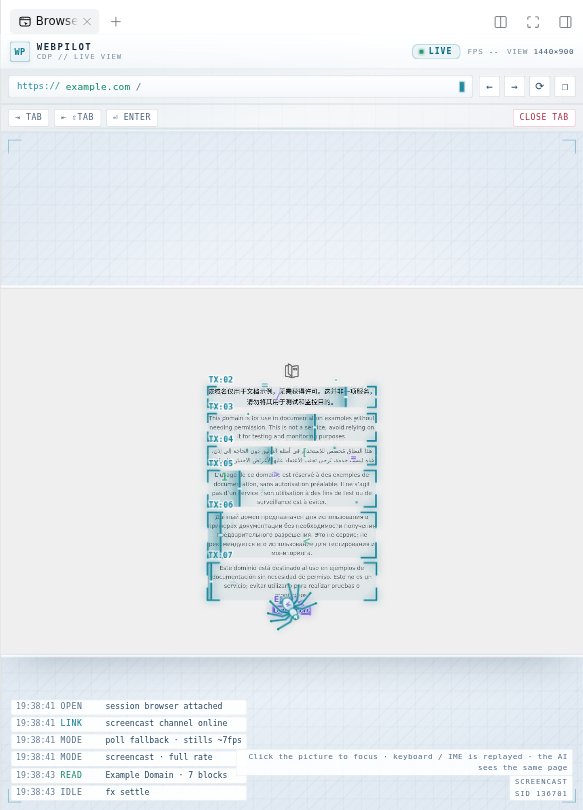

# dsh-webpilot

**English** · [简体中文](README.zh-CN.md)

[](package.json)
[](LICENSE)
[](https://github.com/frankfurtlin/dsh-pocket)

A real Chrome that lives inside the DSH host: one tab per session, driven by `webpilot_*` tools, watched and taken over from the right sidebar.



## The problem

DSH agents run on machines without a display, and the sites they need are behind a login. Headless automation stops at the first step that needs a person: an SSO redirect, an SMS code, a QR code, an image captcha. Sending a screenshot to a chat window does not help either — the person still cannot click the page the agent is on.

## Quick example

A session that has to get past a cloud-console login:

```text
agent   webpilot_navigate("https://console.cloud.tencent.com")
        → Chrome starts, this session gets a tab, the sidebar panel opens

agent   webpilot_snapshot()
        → "登录 / Login" and a QR code: the page is behind a login wall

agent   webpilot_ask_human("Scan the QR code in the sidebar, then press Done.")
        → the tab is brought to the front for the person, the tool call waits

person  scans the code in the panel and presses 完成 / Done

agent   webpilot_snapshot()
        → the project list, three rows with clickable boxes
```

The login now lives in the shared Chrome profile, so the next session is already signed in.

## Install

Adding a plugin row is a startup-time change to the composition, and the `web` profile has no HMR. Restarting DSH also kills the agent turn that runs in the same process, so the installer has to run detached from the agent's process tree:

```sh
sudo systemd-run --unit=dsh-webpilot-install --collect --property=Type=oneshot \
  /bin/bash /root/workspace/plugins/dsh-webpilot/scripts/install.sh
```

The script is idempotent: it backs up the profile manifest, registers the `link:` dependency and the bundle, creates the `node_modules` symlink, restarts the service, waits for the port, swaps the token cookie and probes `/api/dsh-webpilot/health`. On failure it rolls back (manifest and symlink) and restarts once more. The whole run is logged to `scripts/install.log`.

Without systemd, run it in its own process group so the agent's cgroup cannot kill it:

```sh
setsid nohup /bin/bash /root/workspace/plugins/dsh-webpilot/scripts/install.sh >/dev/null 2>&1 &
```

Refresh the Web UI afterwards; the "WebPilot" entry appears in the right-sidebar guide page. No X server is required: `mode: auto` starts a private Xvfb and runs headed there, and falls back to `--headless=new` only if that fails.

Editing the manifest by hand instead: add `"dsh-webpilot": "link:/root/workspace/plugins/dsh-webpilot"` to `dependencies`, append `"dsh-webpilot"` to the `dsh.profile.bundles` array, symlink the package under the profile's `node_modules/`, then restart. To uninstall (the Chrome profile and its logins survive; add `--purge` to delete them):

```sh
sudo systemd-run --unit=dsh-webpilot-uninstall --collect --property=Type=oneshot \
  /bin/bash /root/workspace/plugins/dsh-webpilot/scripts/uninstall.sh
```

Requirements: DSH with a `web` profile (`dsh` engine `>= 0.1.5-rc.2`), Node.js `>= 22.19`, and Chrome or Chromium on the host. Xvfb and SwiftShader are optional, and only matter on a machine without a GPU or a display.

## Usage

The agent gets thirteen tools. `status` reports whether the browser is up and which tab this session owns. `navigate` opens a URL, and `snapshot` reads the page as numbered interactive elements (each with its `box`, and links with their absolute `href`) plus visible text. `click`, `drag`, `type`, `press` and `scroll` act on it with real input events, so focus, hover and React/Vue controlled inputs behave like a human click. `screenshot` returns the page as an image. `wait` blocks until a selector or a piece of text appears (or disappears). `ask_human` hands the tab to a person and blocks until they press Done. `close` closes the tab and leaves the profile alone.

Five of them exist because the plain click-and-type loop is not always enough:

- `snapshot` indexes **the whole page** even though it only prints a window of it, and takes `offset` / `maxElements` / `includeClickables`. A long settings form with sixty switches no longer hides the submit button behind element 80, and role-less clickable `<div>`s (portal dropdowns, custom menus) can be indexed on demand. Links carry their absolute `href`, so a target that only opens behind a tokenised URL can be navigated to directly instead of guessed.
- `drag` presses, moves with the button held and releases, with eased intermediate steps — the only shape a slider CAPTCHA (Alibaba, Tencent, Meituan) accepts. Give it page coordinates (`x1,y1 → x2,y2`, usually read off a screenshot) or an element index plus `dx`/`dy`.
- `wait` replaces guessing `sleep` after an action: it polls for a CSS selector or visible text (default 10s, cap 120s) and returns what matched, or `matched:false` on timeout instead of throwing.
- `type` accepts `replace: true`, which clears the field first. Without it `Input.insertText` appends, so re-entering a corrected value silently produces "oldvalue newvalue".
- `eval` runs a JS expression in the page and returns JSON. Reading `localStorage`, calling the site's own API with the logged-in session, or batching a hundred DOM actions in one round trip all beat screenshot-and-click. It runs with the page's own origin and cookies.
- `click` also accepts `x` / `y` for the case where the target only exists visually.

`ask_human` is built for the way QR logins actually fail: it re-requests an expired code before the human looks and every ten seconds while waiting, and its result carries a `loginState` probe (`loggedIn: true/false/null` plus the evidence — a login CTA still on screen, account navigation appearing, or new cookies landing).

For the human, the panel in the right sidebar is a live picture: CDP screencast into a canvas. It accepts mouse, wheel, keyboard and IME input and replays it into the tab the agent is using, so it is not a screenshot viewer. The address bar works: click it, type, press Enter. Back, forward and reload sit next to it. A status line reads `● LIVE`, `STANDBY` or `HUMAN-TAKEOVER`, and the bottom-left HUD logs every agent action. Effects — spider-cursor flight, click ripples, reading scanline, scroll bands — are painted on the panel's own overlay canvas, never injected into the visited page, and they respect `prefers-reduced-motion`.

Example prompts:

> Open https://example.com with webpilot_navigate, read the page with webpilot_snapshot, then click the first link.

> Open https://console.cloud.tencent.com. If it asks for a login, call webpilot_ask_human and ask me to scan the QR code.

Login state lives in `$DSH_HOME/webpilot/profile` by default and is shared by every session. `webpilot_close` and the idle shutdown do not touch it.

## Configuration

Override fields in the profile's patch layer. `config` replaces the whole key; it is not a deep merge:

```yaml
- id: webpilot
  config:
    mode: headless              # auto | headed | headless
    viewport: 1440x900          # page viewport, also the effect coordinate space
    idleShutdownMinutes: 30     # stop Chrome after N idle minutes; 0 = never
    effects: true               # false = the host stops emitting fx events
    effectLeadMs: 260           # time reserved for the animation before the action lands
    lazyTools: false            # true = publish the tools only after the browser-use skill gate
    languages: 'zh-CN,zh,en'    # empty = inherit the host
    timezone: 'Asia/Shanghai'   # empty = inherit the host
    extraArgs:
      - --enable-unsafe-swiftshader
```

The fields below are the ones worth knowing. The full list is `DEFAULT_CONFIG` in `lib/index.js`.

| Field | Default | Meaning |
|---|---|---|
| `browserPath` | `''` | Chrome/Chromium binary; empty = auto-detect |
| `profileDir` | `''` | Persistent profile; empty = `$DSH_HOME/webpilot/profile` |
| `mode` | `auto` | Headed on a private Xvfb when possible, otherwise headless |
| `screen` / `windowSize` / `viewport` | `1440x900x24` / `1440x900` / `1440x900` | Virtual display, Chrome window, page viewport |
| `port` | `0` | Fixed DevTools port; 0 picks a free one |
| `startUrl` | `about:blank` | First URL of a new session tab |
| `snapshotMaxChars` / `maxElements` | `4000` / `80` | Snapshot text budget and element cap |
| `screencastQuality` / `screencastMaxWidth` | `60` / `1440` | Panel picture quality and stream width |
| `askHumanTimeoutSeconds` | `600` | Default budget for `webpilot_ask_human` |
| `idleShutdownMinutes` | `10` | Stop Chrome after N idle minutes; 0 keeps it alive |
| `autoStart` / `startTimeoutMs` | `false` / `20000` | Start with the host; wait for the DevTools endpoint |
| `effects` / `effectLeadMs` / `lazyTools` | `true` / `260` / `false` | Panel effects, their lead time, tool gating |

`languages` and `timezone` matter for sites you log into. Headless Chrome answers `en-US` and `Etc/Unknown` (offset 0); if the account sits in UTC+8, a browser that reports UTC is one of the strongest bot-wall signals. `mode: auto` with Xvfb also reports a real 1440x900 screen (headless says 800x600), and WebGL needs the SwiftShader fallback.

The installer reads `DSH_PROFILE_DIR` (default `/root/.dsh/profiles/web`), `DSH_SERVICE` (default `deepseek-harness`), and `DSH_WEB_HOST` / `DSH_WEB_PORT` (default `127.0.0.1:3080`). The plugin reads `DSH_HOME`.

## What it doesn't do

- It is not a remote desktop. Native dialogs, file pickers and browser chrome are outside the panel.
- It cannot pass a silent bot wall. A person can solve an interactive challenge in the panel, but a managed challenge that never shows a human-solvable step is a hard stop (for example `zh.minecraft.wiki`), and the plugin reports it instead of pretending.
- It does not isolate identities. Sessions are isolated by page state, not by login: all sessions share one profile and therefore one set of logins. That is the product, and also its main risk.
- It does not keep the browser running forever. Chrome stops after `idleShutdownMinutes` (default 10) and open tabs go with it; the profile and logins stay.
- It cannot see a long page at once. `snapshot` truncates text (4000 characters by default) and lists at most 80 elements, so long pages need scrolling or a second snapshot.
- It cannot inject tools into old sessions. Tools are published per session; sessions created before installation may not see `webpilot_*` until they are restarted.

## Docs

The Chinese README is the full reference: [README.zh-CN.md](README.zh-CN.md). Sections worth opening:

- **能力**: the full tool table and every panel detail.
- **配置**: the complete configuration surface and the environment variables.
- **验收**: the recorded e2e and production runs, with screenshots.
- **安全**: the security model in full.
- **与上游的关系 / 许可**: what this fork changes and where the code came from.

Design and engineering notes are in [docs/RESEARCH.md](docs/RESEARCH.md), [docs/INTERFACE.md](docs/INTERFACE.md) and [docs/HANDOFF.md](docs/HANDOFF.md); the e2e harness is described in [e2e/README.md](e2e/README.md). To re-run everything: `node e2e/run-all.mjs` (isolated dev instance on port 3090, never touches production), or a single script such as `node e2e/backend-smoke.mjs`.

## Contributing

Issues and pull requests are welcome. Run the e2e suite before sending a patch, keep the change small, and check with the maintainer before adding a runtime dependency: the fork is deliberately dependency-light, with a hand-written CDP client.

## License

MIT — see [LICENSE](LICENSE). This is a vendored fork of [`imroc/dsh-embedded-browser`](https://github.com/imroc/dsh-embedded-browser) v0.3.0 (MIT). The upstream README is kept at [docs/UPSTREAM-README.zh.md](docs/UPSTREAM-README.zh.md), and `LICENSE` keeps the upstream copyright notice (`Copyright (c) 2026 roc`); this repository adds no separate copyright line.
