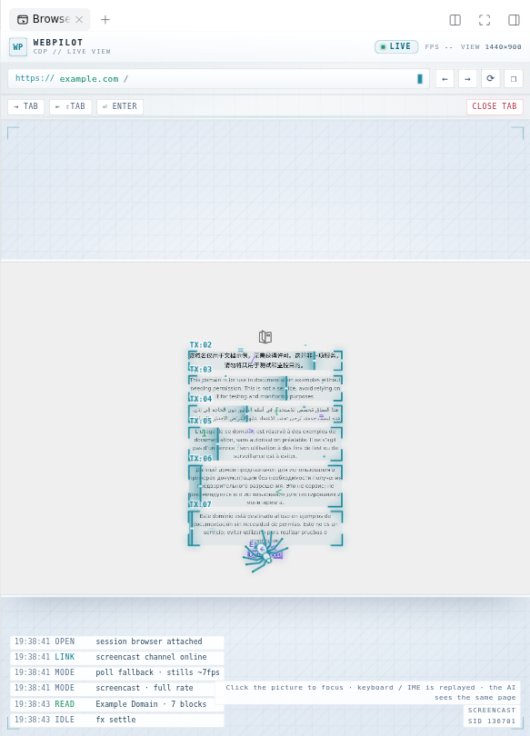

<div align="center">

# dsh-webpilot 「内嵌浏览器」

**把浏览器搬进 DSH 宿主：每个会话一个标签页，AI 用 `webpilot_*` 工具操作，你在右侧栏实时看着并随时接手。**

[](package.json)
[](LICENSE)

[English](README.md) · **简体中文**

</div>



## 这是什么

dsh-webpilot 在 DSH 宿主里常驻一个 Chrome，每个会话在其中拥有自己的标签页。agent 通过 `webpilot_*` 工具操作本会话的页面，人可以随时在右侧栏面板里看着、点着、登录；所有会话共用一个持久 Chrome profile，登录一次到处可用。不需要显示器，headless 机器也能跑。

## 功能

- **每会话一个标签页**：同一个 Chrome、同一份 profile，页面状态按会话隔离，登录态共享。
- **十一个工具**：`navigate` / `snapshot` / `click` / `type` / `press` / `scroll` / `screenshot` / `eval` / `status` / `ask_human` / `close`。

  其中四个是这轮实战踩坑后补的：

  - `snapshot` 现在**给整页元素编号**，只按窗口返回（`offset` / `maxElements` / `includeClickables`）。之前 60 多个开关的长表单会把提交按钮挤到 80 号之外，直接失去编号；portal 渲染的下拉菜单是无 role 的 `<div>`，也需要 `includeClickables` 才抓得到。
  - `type` 支持 `replace: true`，先清空再输入。否则 `Input.insertText` 是追加，改值会变成「旧值新值」拼在一起。
  - `eval` 在页面里跑一段 JS 并返回 JSON：读 `localStorage`、用已登录会话调站点自己的接口、一次批量做上百个 DOM 操作，都比截图点来点去可靠。它使用页面自身的 origin 与 Cookie。
  - `click` 增加 `x` / `y`，用于只存在于视觉上、没有可用 DOM 节点的目标。
- **右侧栏实时画面**：CDP screencast 画到 canvas，鼠标、滚轮、键盘、输入法都能回灌到 agent 正在用的标签页；地址栏可直接输入跳转。
- **操作特效 overlay**：蜘蛛光标飞行、点击涟漪、**拖拽轨迹**（底轨虚线 + 随拖拽生长的实线 + 落点 DROP 括号）、阅读扫描线、滚动光带，全部画在面板自己的 canvas 上，不注入被访问页面，尊重 `prefers-reduced-motion`。
- **请人帮忙**：`webpilot_ask_human` 把标签页交给真人处理扫码/验证码，人点「我已完成」后工具调用才返回。
- **无显示器可用**：`mode: auto` 自动起 Xvfb 走 headed，失败才退回 `--headless=new`；UA、语言、时区可配。

## 安装

下面的命令假设仓库检出在 `/opt/dsh/dsh-webpilot`，放在别处就替换成实际路径。

```bash
sudo systemd-run --unit=dsh-webpilot-install --collect --property=Type=oneshot \
  /bin/bash /opt/dsh/dsh-webpilot/scripts/install.sh
```

## 详细文档


> 住进 DSH 宿主里的浏览器。每个会话在同一个 Chrome 里拥有自己的标签页；你在 **Web UI 右侧栏**里看这一页、
> 随时接手，AI 用 `webpilot_*` 工具在同一页上读和操作；所有动作都以 cyber-spider 风格的特效画在面板上，
> 一眼能看出它在点什么、读哪里。**持久 profile**：扫码登录一次，所有会话、重启之后都还在。

基于 [`imroc/dsh-embedded-browser`](https://github.com/imroc/dsh-embedded-browser) v0.3.0（MIT）的
vendored fork，叠加了 WebPilot 的视觉与特效层。调研背景见 [docs/RESEARCH.md](docs/RESEARCH.md)。


## 为什么需要它

agent 跑在没有显示器的机器上，而它要用的站点都在登录后面。纯无头自动化会在「需要真人」的第一步卡死：
SSO 跳转、短信/邮箱验证码、扫码登录、图形验证码。WebPilot 把这一步交还给人——**就在 AI 正在操作的那个
标签页上**，人扫码/点按之后，AI 带着同一个登录态继续往下做，结果落进持久 profile，登录一次到处可用。

## 能力

### 模型工具（`webpilot_*`）

| 工具 | 作用 |
|---|---|
| `webpilot_status` | 浏览器是否在跑、本会话标签页的 URL/标题、有没有待人工处理的动作 |
| `webpilot_navigate` | 在本会话标签页打开网址（首次调用启动浏览器） |
| `webpilot_snapshot` | 读页面：标题、URL、带编号的可交互元素（含 `box` 坐标、链接的绝对 `href`）、可见正文 |
| `webpilot_click` | 按元素编号、可见文字或页面坐标点击，派发真实输入事件；**动作前预检**（被遮挡 / `disabled` / `[inert]` / 出视口就拒绝并点名遮挡者），**动作后断言**（`changed` / `navigated` / `mutations`） |
| `webpilot_drag` | **真实拖拽**：按下 → 按住移动 → 抬起，滑块验证码（阿里/腾讯/美团）唯一认的形态；给坐标或「元素编号 + dx/dy」 |
| `webpilot_type` | 聚焦字段并注入文本（兼容 React/Vue 受控输入），可 `replace` 先清空、可顺带回车提交 |
| `webpilot_press` | 按一个键（Enter/Tab/Escape/方向键/PageUp/Down…） |
| `webpilot_scroll` | 滚动（down/up/left/right/top/bottom） |
| `webpilot_wait` | **等条件成立**：选择器出现 / 文本出现（`gone:true` 则等消失），默认 10s、上限 120s，超时返回 `matched:false` 不抛错 |
| `webpilot_screenshot` | 截图作为图片附件返回给模型 |
| `webpilot_eval` | 在页面上下文里跑 JS 并取 JSON 结果（读 localStorage、借用登录态调接口、批量 DOM 操作） |
| `webpilot_ask_human` | **请人帮忙**：把本会话标签页调到面板，阻塞等你点「我已完成」。等待期间每 10s 检查二维码是否失效并自动刷新；结束时返回 `loginState`（`loggedIn` + 证据） |
| `webpilot_close` | 关闭本会话标签页（profile 与登录态保留） |
动作类工具（`click`/`type`/`press`/`drag`）都会带上一句"成了没"：页面里装一个 MutationObserver 记账，动作后按「变更计数 + 静默时长」判定 `navigated` / `changed` / 无变化；`type` 还会读回字段值（受控输入把字吞掉时，DOM 一次都不会变）。

### 右侧栏面板

- 会话有浏览器标签页时自动弹出；右侧栏引导页里也有「WebPilot」入口可手动打开。
- 面板是**实时画面**（CDP screencast → canvas），同时接受真实鼠标/滚轮/键盘/输入法，事件回灌进 AI 正在用的那个标签页——不是截图查看器。
- 顶部是**能真正输入地址栏**：点一下直接打字，`Enter` 打开（裸域名自动补 `https://`，`localhost` 补 `http://`，
  `Ctrl/⌘+L` 聚焦、`Esc` 取消）；旁边是后退 / 前进 / 刷新。人不用再委托给 agent 才能换网址。
- 配色是**浅色**，跟随 Web GUI 的主色调：白玻璃底、蓝灰细线、加深版强调色；不再是大面积深色控制台。
- 顶部状态条：`● LIVE` / `STANDBY` / `HUMAN-TAKEOVER`；左下 HUD 记录 agent 的每一次动作。
- 操作特效（全部画在面板自己的 overlay canvas 上，不注入被访问页面）：蜘蛛光标飞行定位、点击涟漪 + 目标括号、拖拽轨迹（整段虚线底轨 + 生长实线 + 落点 DROP 括号，白衬底保证深浅底色都看得清）、
  阅读扫描线 + 数据粒子、滚动光带、导航故障闪屏。尊重 `prefers-reduced-motion`。
- 接管横幅只出现在发起请求的那个会话的面板里；点「我已完成」即让等待中的工具调用返回（可以顺手留一句话）。

## 安装

新增插件行属于**启动期**组合变更（web profile 没有 HMR），要重启承载 DSH 的进程。如果 DSH 是 systemd 托管
且你也从同一个进程里让 agent 干活，重启会杀掉正在跑的那一轮对话——所以安装脚本必须**脱离 agent 的进程树**运行。

```sh
# 幂等脚本：备份 profile 清单 → 登记 dependency(link:) + bundles → 建 node_modules 软链
#            → systemctl restart → 等端口 → 换 token cookie → 打 /api/dsh-webpilot/health
# 失败自动回滚（清单 + 软链 + 再重启一次）。全过程写 scripts/install.log。
sudo systemd-run --unit=dsh-webpilot-install --collect --property=Type=oneshot \
  /bin/bash /opt/dsh/dsh-webpilot/scripts/install.sh

# 或者不经 systemd 的等价方式（只需进程组脱离，且确认不会被 cgroup 连带杀掉）：
#   setsid nohup /bin/bash /opt/dsh/dsh-webpilot/scripts/install.sh >/dev/null 2>&1 &
```

装完刷新 Web UI，右侧栏引导页里会出现「WebPilot」。没有 X server 也能跑：`mode: auto` 下自动起一个 Xvfb 虚拟显示走 headed（页面看到真实 1440x900 屏幕），起不来才退回 `--headless=new`。

卸载（保留 Chrome profile，登录态不丢；加 `--purge` 连 profile 一起删）：

```sh
sudo systemd-run --unit=dsh-webpilot-uninstall --collect --property=Type=oneshot \
  /bin/bash /opt/dsh/dsh-webpilot/scripts/uninstall.sh
```

手动安装（自己改清单时）：`dependencies` 加 `"dsh-webpilot": "link:/opt/dsh/dsh-webpilot"`，
`dsh.profile.bundles` 数组末尾加 `"dsh-webpilot"`，再在 profile 的 `node_modules/` 里建同名软链，最后重启。

## 使用

**人**：右侧栏打开 WebPilot → 看到 AI 正在操作的页面 → 需要登录时，AI 调 `webpilot_ask_human`，横幅出现，你直接扫码/输密码，完成后点「我已完成」。

**AI**（示例话术）：

> 用 webpilot_navigate 打开 https://example.com，webpilot_snapshot 读一下，然后点第一个链接。

> 打开 https://console.cloud.tencent.com ，如果要求登录就调 webpilot_ask_human，说明「请扫码登录，完成后点我已完成」。

登录态在 `$DSH_HOME/webpilot/profile`（默认），多个会话共享；`webpilot_close` 或空闲回收都不影响它。

## 配置

在 profile 的 patch 层覆盖（`config` 是整键替换）：

```yaml
- id: webpilot
  config:
    mode: headless              # auto | headed | headless
    viewport: 1440x900          # 页面视口，也是面板特效坐标系
    idleShutdownMinutes: 30     # 空闲回收；0 = 永不
    effects: true               # 关掉则宿主不发 fx 事件
    effectLeadMs: 260           # 动作前给动画留的时间
    lazyTools: false            # true = 由 browser-use 技能开闸后才发布工具
    languages: 'zh-CN,zh,en'    # 空 = 沿用宿主；非空则加 --lang / --accept-lang
    timezone: 'Asia/Shanghai'   # 空 = 沿用宿主；非空则注入 Chrome 进程的 TZ
    extraArgs:                  # 追加启动参数，例如无 GPU 机器的软件渲染兜底
      - --enable-unsafe-swiftshader
```

完整字段见 `lib/index.js` 的 `DEFAULT_CONFIG`。

`languages` / `timezone` 是给「要登录的网站」准备的：headless 默认答 `en-US` + `Etc/Unknown`（偏移 0），
而账号所在时区是 UTC+8 —— 出口 IP 在广州、浏览器却按 UTC 说话，是风控打分里最重的矛盾之一。
配 `mode: auto` + Xvfb 后页面还能看到真实 `screen 1440x900`（headless 报 `800x600`）；`webgl` 需要
SwiftShader 兜底（否则 headed 下 `getContext('webgl')` 直接是 `null`，比软件渲染更像机器人）。

## 验收

```sh
node e2e/backend-smoke.mjs   # 宿主半：真实 Chrome、fx 顺序、点击真到页面、截图（不依赖 DSH）
node e2e/routes-smoke.mjs    # HTTP：鉴权闸门、health/sessions/state、open→close
node e2e/auto-reveal.mjs     # 全新 Chrome profile：有页面时右栏自动展开、手动收起后不重开
node e2e/address-bar.mjs     # 面板地址栏：输入→回车→真跳转、裸词拒绝、Ctrl+L/Esc、无文字重叠
node e2e/gui-verify.mjs      # 真实 agent 一轮：面板 LIVE、画面、NAV/READ HUD、fx 上色、0 console error
node e2e/run-all.mjs         # 串起来跑，写一份 e2e/shots/run-all-*/summary.json
```

验收走的是**隔离 dev 实例**（`DSH_HOME=~/workspace/.dsh-dev`，端口 3090，raw CDP 驱动，无 Playwright），
永远不会碰线上 3080；步骤与产物说明见 `e2e/README.md`。

本机实测（2026-11-18）：`run-all` **5/5 步全 PASS** —— backend 57/57、routes 23/23、auto-reveal 15/15、address-bar 16/16、gui-verify 24/24；
截图见 `e2e/shots/<run>/`（`hero/hero-panel.png` 为面板 + 页面 + HUD 的成品图，`03-panel-standby.png` 为空态）。
安装到线上后的自动探测为 `scripts/postinstall-gui.mjs`（9 项：GUI 正常启动、右栏壳在、health 200、无未捕获异常），
`scripts/install.sh` 在健康检查通过后会自动跑它（探测失败不影响安装结论）。

### 线上实测（2026-11-18，3080 端口，安装后）

- `scripts/install-result.json`：`ok:true`、health `200`、service `active`；
- `scripts/postinstall-gui.json`（探测在本机生成，**不入库**）：**9/9 PASS**（GUI 渲染、右栏壳挂载、composer 存在、health/state 均 200、0 未捕获异常）；
- 用同一套 `gui-verify` 打线上跑完整一轮：**24/24 PASS** —— 真实 agent 会话调到 `webpilot_navigate` 打开 example.com、
  `webpilot_snapshot` 读页，面板自动浮现并 LIVE，HUD 出现 `NAV`/`READ`，fx 实际绘制，0 console error；
  证据：`e2e/shots/live-2026-11-18/`（`05c-panel-live-clip.png` 是成品特写）。

> 工具（`webpilot_*`）按会话注入：插件装好后**新开的会话**才有；装之前就存在的会话可能仍看不到它们。

改动与踩坑记录见 `docs/HANDOFF.md`（交接/回归用）。

## 安全

- 面板与 WebSocket 和 DSH Web UI **同一套认证**（`connection.requestRejection`）；能看面板的人本来就能操作宿主浏览器。
- 会话之间隔离的是**页面状态**，不是身份：共享 profile 意味着所有会话共享同一批登录态——这是产品意义所在，也是风险所在。
- profile 里是真实会话，只留在宿主本地，不上传。
- CDP 端口只绑 127.0.0.1；输入回灌只走基线白名单消息，不向页面暴露 `Runtime.evaluate`。
- 尽量用非 root 跑 Chrome 并保留沙箱；只在宿主是 root 时才自动补 `--no-sandbox`。
- 反爬提示：headless 的 UA 已修正 + 关闭 `AutomationControlled`；交互式人机验证可由人在面板上点过，**静默 managed 挑战是硬阻断**（如 zh.minecraft.wiki），遇到会如实说明。

## 与上游的关系 / 许可

- 基线：`imroc/dsh-embedded-browser` v0.3.0，MIT。原始说明见 [docs/UPSTREAM-README.zh.md](docs/UPSTREAM-README.zh.md)，
  许可证与版权声明见 [LICENSE](LICENSE)。
- 本项目改动：重命名（工具/路由/profile 目录）、去掉对 `@deepseek-ai/dsh-tools`、`@deepseek-ai/schemastery`
  的运行时依赖（改用本地 shim）、新增 fx 事件层（元素盒模型 + 操作前事件 + 阅读区域）、Chrome UA/反自动化参数、
  客户端视觉层重写与特效 overlay。同样以 MIT 发布，保留上游版权声明。
